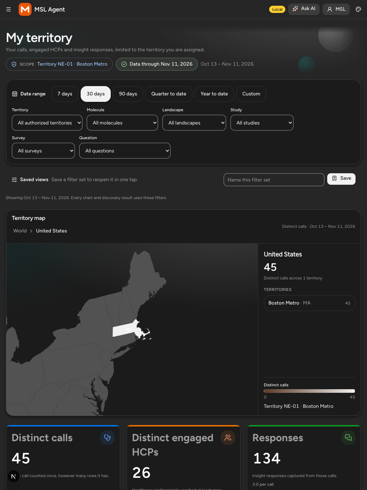
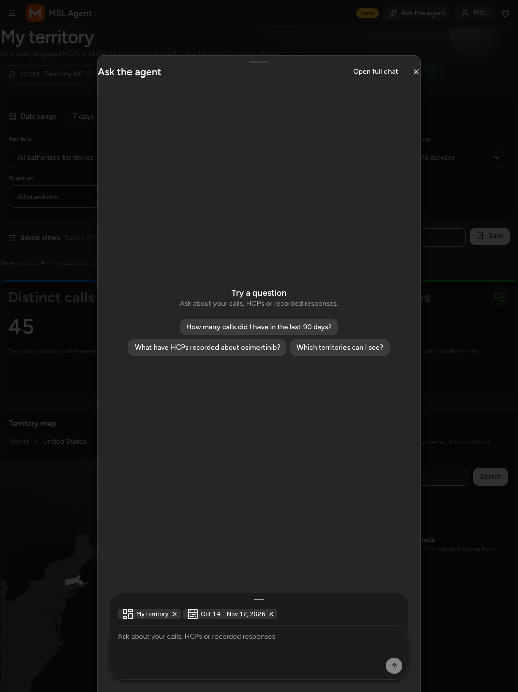
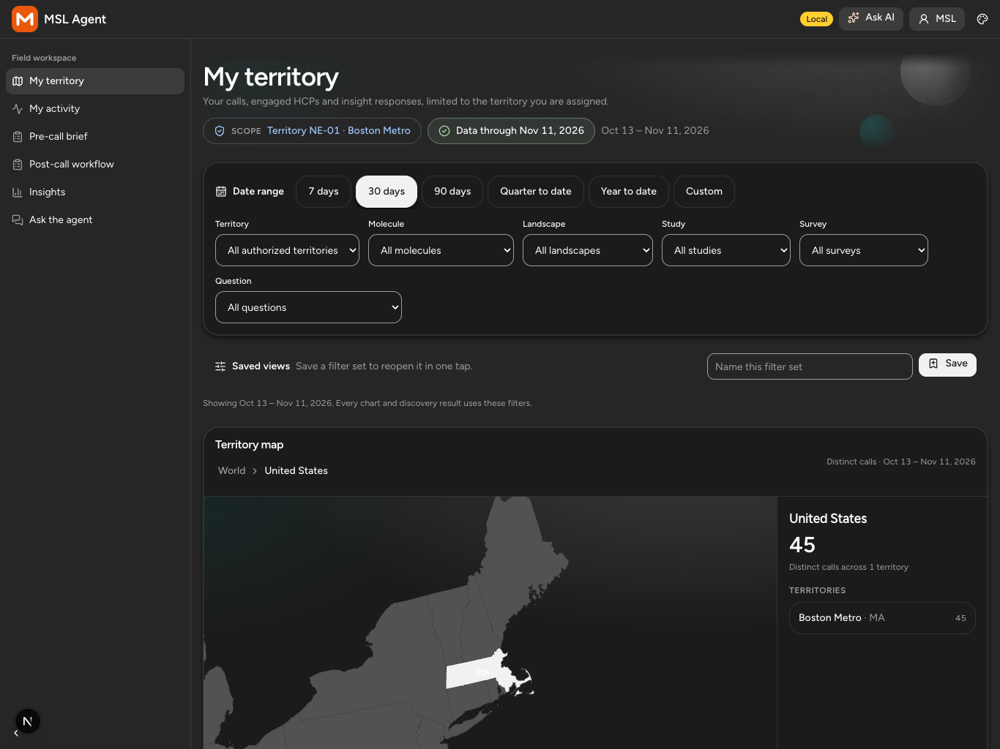
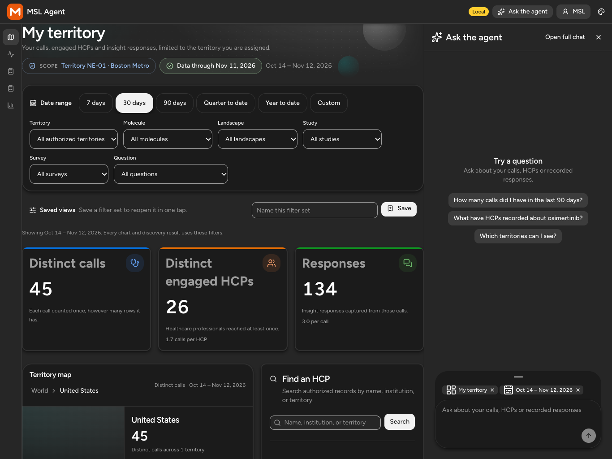
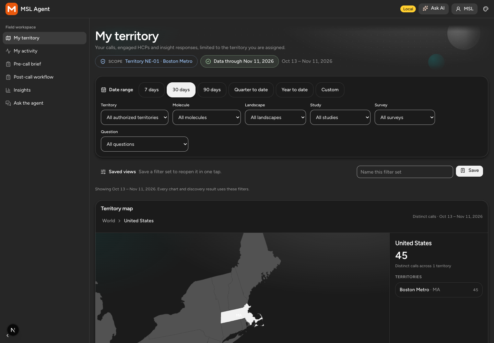
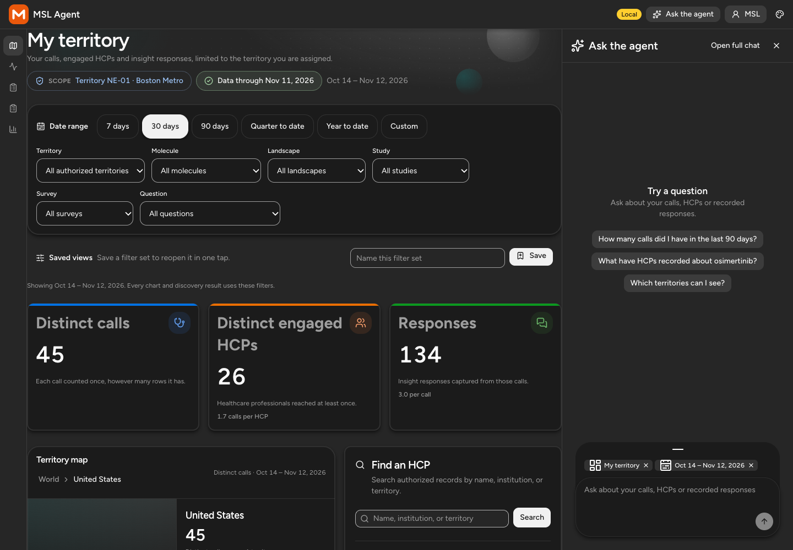

# Layout system

Use this system when adapting a page that lives inside the authenticated shell.
It is the common contract for a dense, calm workspace from iPad portrait through a wide desktop.

## Decision and research

The one chat experience is named **Ask the agent**.
It has one persistent entry in the global header and no persona-sidebar duplicate.
On a wide workspace it is an inspector-style supporting pane beside the current task.
On narrower workspaces it is an overlay, and its full route remains `/chat` for focused, long-form work.
This keeps role-gated navigation intact while avoiding three competing ways to ask the same question.
When the inspector docks, the persistent sidebar becomes its existing icon rail so the three-pane workspace retains a useful main region.

Apple recommends split views for adjacent panes, asks iPad apps to handle narrow, compact, and intermediate widths, and describes the sidebar, primary content, and inspector relationship directly in its [split-view guidance](https://developer.apple.com/design/human-interface-guidelines/split-views).
Its [layout guidance](https://developer.apple.com/design/human-interface-guidelines/layout) says to respect safe areas, margins, and size classes instead of inferring space from device orientation alone.
Its [sidebar guidance](https://developer.apple.com/design/human-interface-guidelines/sidebars) also supports retaining a discoverable leading navigation area only when room permits it.

Material 3 defines [feed, list-detail, and supporting-pane](https://m3.material.io/foundations/layout/canonical-examples/overview) as its three canonical responsive layouts.
The supporting pane is approximately a two-thirds primary task area with a one-third secondary area, which is the model used for dashboard detail and Ask the agent.

The Astryx research used the project CLI rather than re-creating layout primitives: `pnpm exec astryx docs layout`, `pnpm exec astryx build "dense responsive healthcare dashboard with persistent AI side panel"`, and `pnpm exec astryx template`.
The resulting implementation uses `AppShell`, `Layout`, `LayoutPanel`, `Grid`, `GridSpan`, `Drawer`, `BottomSheet`, `ChatComposerDrawer`, and `Token` rather than bespoke layout containers.
The [Astryx design system](https://astryx.atmeta.com/) provides the accessible primitives, templates, spacing scale, and theme behavior that this system keeps consistent.

Modern Web Guidance research used `npx modern-web-guidance@latest search` for responsive container queries, drawers, and layout stability before implementation.
Its `responsive-design` and `css-layout` guidance led to component-scoped `@container` rules and flexible `minmax(0, 1fr)` tracks, rather than a device-specific collection of media queries.

## Shell and density contract

- Every authenticated page is already inside `PageFrame`: the shell wraps it. Do not add another one in a page, and do not put your own horizontal padding on a page root. `PageFrame` owns the single page gutter (spacing `4` on every side), so no page content ever touches the sidebar or the screen edge.
- Use Astryx `Layout` for a named header, main region, and supporting region.
- Use Astryx `Grid` and `GridSpan` for dashboard regions, and `VStack` or `HStack` for a single flow direction.
- Use the spacing scale: `4` between dashboard regions, `6` between page sections, and the shell's compact header instead of per-page hero padding.
- Keep the header to identity, navigation, and essential global actions.
- Put primary data and actions above decorative material, and do not add a full-width Card merely to create separation.
- Keep prose inside an inner text layout with a maximum comfortable measure of 65 to 75 characters per line.
- Keep operational labels, filters, and compact evidence metadata dense but readable, with 44px minimum touch targets on touch viewports.
- Use tabular figures for changing KPI values and reserve chart space before asynchronous content arrives.

## Responsive grid

`DashboardGrid` is one track by default.
Its named container becomes 12 tracks when the content container reaches `56rem` (896px), which a 1024px iPad viewport reaches after the shared page margins.
The container condition, rather than a global breakpoint, lets the grid respond correctly when a side navigation rail or inspector consumes width.
Apply the same rule to card internals: a component may create its own named container and stack its cards until its own content area, not the browser viewport, is wide enough.

| Region | Compact and constrained containers | 12-track container |
| --- | --- | --- |
| KPI row | Single horizontal scan or responsive KPI row | Fill the available row before secondary panels |
| Primary chart with concise evidence | Full width | 8 tracks |
| Secondary chart, evidence, or qualitative panel | Below primary | 4 tracks beside primary |
| Focused visual with a working lookup or inspector | Full width | 7 tracks |
| Lookup or inspector that needs a useful input measure | Below focused visual | 5 tracks beside focused visual |
| Two peer charts | Stack | 6 tracks each |
| Table, catalog, or long evidence stream | Full width | 12 tracks |

Do not use `grid-auto-flow: dense` for controls or interactive cards, because it can put visual and keyboard order out of sync.
Put charts side by side only when each retains a useful legend, axis labels, and a minimum readable plot area.
Use the 8/4 primary-secondary pair for a chart with concise evidence. Use the 7/5 focus-detail pair for a map or visual with an interactive lookup or inspector. If a paired chart becomes difficult to scan, promote the comparison to a full-width region.

## Page patterns

| Content | Pattern | Use it when |
| --- | --- | --- |
| Overview and monitoring | Feed / dashboard grid | The user needs a scan of KPIs, charts, and alerts. |
| HCP, territory, or evidence drilldown | List-detail | Selecting a record should preserve the list while showing its evidence. |
| Chart with interpretation, search, or Ask the agent | Supporting pane | Secondary work helps the main task without replacing it. |
| Long form, policy, or a focused AI conversation | Single readable column | Sequential reading and authoring matters more than comparison. |

For a drilldown, keep the current list or chart stable and put the selected evidence in a detail pane or sheet.
Do not turn an evidence selection into a second full-page scroll if there is a viable list-detail or supporting-pane arrangement.

## Adaptive arrangements

| Window class | Arrangement | Ask the agent |
| --- | --- | --- |
| iPad portrait, including 1024x1366 | Compact header, navigation drawer, 12-track dashboard where its content container qualifies, and KPI row first | Tall bottom sheet so the current page remains intact below it. |
| iPad landscape, 1366x1024 | Icon navigation rail, 12-track dashboard, and primary/supporting regions side by side | Docked supporting pane, which reflows the main task instead of covering it. |
| Desktop 1280 to 1365 | Inline navigation where available, dense dashboard grid when the container qualifies | Right overlay Drawer so the main analysis remains usable. |
| Desktop 1366 to 1920 | Inline navigation when chat is closed; icon rail and 12-track grid when it docks | 420px docked inspector beside reflowed content. |

The 1366px Ask the agent threshold is deliberately separate from the 896px dashboard-container threshold.
The first protects the workspace when a chat pane opens, while the second lets a component use the room it has.
When a wide shell is resized below 1366px, Ask the agent changes presentation but the conversation and route do not change.

## Ask the agent context

The header button is always labelled **Ask the agent** outside `/chat`.
The panel shows a removable token for the active page, date range, territory, product, and question when those filters are present.
Removing a token only changes the context for the next question, never the page filters themselves.
The API contract currently serializes page, range, territory, and question context.
The active product is deliberately visible and removable without widening the backend contract in this frontend-only change.

Use the full `/chat` route from the panel's **Open full chat** action.
Do not add a second chat launcher to a persona navigation list or embed a competing chat surface in a page.

## MSL exemplar

The MSL home page applies the system as the reference implementation.
Its KPI row fills the page width, then the territory map and HCP lookup occupy a 7/5 focus-detail pair.
Response distributions and qualitative insights use an 8/4 primary-secondary pair, while the question catalog returns to the full width.

The screenshots are annotated by viewport and observed arrangement so future page migrations can compare like-for-like dimensions.

### iPad portrait - 1024x1366

Before - one full-width flow makes the HCP lookup and chart regions consume extra vertical scroll.

After - the shell keeps navigation off-canvas and Ask the agent is a tall sheet over the unchanged page.

### iPad landscape - 1366x1024

Before - primary work and supporting work stack, leaving horizontal room unused.

After - 12 tracks create a 7/5 map-and-HCP pair, and Ask the agent docks as an inspector.

### Desktop - 1440x1000

Before - the dashboard is a tall linear page and chat competes from multiple entry points.

After - the supporting pane reflows the map and evidence work, while Ask the agent has one persistent global entry.

## Page-by-page adoption checklist

1. Start with `pnpm exec astryx build "<page intent>"` and rely on the shell's `PageFrame` (do not nest another).
2. Choose a feed, list-detail, supporting-pane, or readable-column pattern before moving components.
3. Assign every dashboard region a `DashboardGridItem` area and check its compact reading order.
4. Keep KPIs full width and reserve side-by-side pairs for charts or panels that remain independently legible.
5. Use `LayoutPanel`, `Drawer`, or `BottomSheet` for secondary work instead of raw positioned elements.
6. Check 1024x1366, 1366x1024, 1440x1000, text zoom, keyboard order, and no horizontal overflow.
7. Capture before and after evidence at those viewports and add the page to the responsive Playwright matrix.

## Scroll-screen audit

Page height divided by viewport height (1.00 means no scrolling), measured on a production build with the mock adapter and the default look; `/login` is not listed because the local build redirects it to `/msl`. Only the changed cells show before → after. Pages that are table or evidence streams (`/admin/evals`, `/director/insights`, `/design`) stay long by content, not by layout.

| Page | iPad portrait 1024x1366 | iPad landscape 1366x1024 | Desktop 1470x956 | Desktop 1920x1080 |
|---|---|---|---|---|
| `/msl` | 1.72 | 2.27 | 2.31 | 2.00 |
| `/msl/follow-up` | 1.00 | 1.00 | 1.00 | 1.00 |
| `/msl/activity` | 1.00 | 1.28 | 1.42 | 1.45 |
| `/msl/insights` | 1.00 | 1.00 | 1.00 | 1.00 |
| `/msl/briefs` | 1.00 | 1.00 | 1.00 | 1.00 |
| `/director` | 3.65 → **3.52** | 4.70 → **4.51** | 4.86 → **4.63** | 4.19 → **4.10** |
| `/director/insights` | 7.62 → **7.55** | 9.80 → **9.71** | 9.96 → **9.86** | 8.19 → **8.10** |
| `/executive` | 3.29 | 4.32 | 4.41 | 3.75 |
| `/executive/themes` | 2.61 | 3.27 | 3.33 | 2.37 |
| `/executive/trends` | 1.69 | 2.13 | 2.22 | 1.89 |
| `/admin` | 2.77 → **2.62** | 3.70 → **3.50** | 3.79 → **3.58** | 3.32 → **3.11** |
| `/admin/ingestion` | 1.00 | 1.33 | 1.40 | 1.24 |
| `/admin/governance` | 1.29 | 1.72 | 1.78 | 1.57 |
| `/admin/evals` | 3.50 | 4.39 | 4.64 | 4.10 |
| `/chat` | 1.00 | 1.00 | 1.00 | 1.00 |
| `/design` | 8.84 → **8.70** | 11.72 → **11.53** | 11.68 → **11.48** | 10.36 → **10.18** |

Remaining stragglers worth a dedicated pass: the Director insights exceptions table and theme cards, the Executive territory and engagement stacks, and the Admin assignment and audit forms, which are form-dense and need their own list-detail design.
